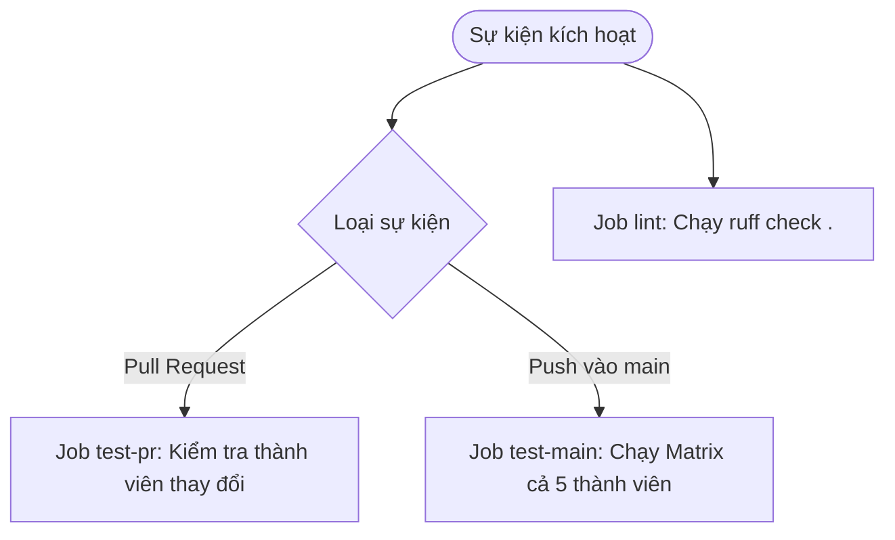

# Hướng dẫn Môi trường, Kiểm thử Cục bộ và CI — TV3 (Phan Quỳnh Quyền)

Tài liệu này hướng dẫn cách thiết lập môi trường lập trình Python chuẩn cho dự án **Python Bootcamp (Week 1)** của Team03, cách chạy các kiểm thử cục bộ (`pytest`, `ruff`), và giải thích cơ chế tự động hóa tích hợp liên tục (CI) qua GitHub Actions.

---

## 1. Yêu cầu Môi trường & Thiết lập Môi trường ảo (Virtual Environment)

Môn học CSC10014 khuyến nghị sử dụng **Python 3.12** (hoặc các phiên bản tương thích từ 3.12 đến 3.14).

### 1.1 Tạo và kích hoạt môi trường ảo (`.venv`)

Từ thư mục gốc của repository (`python-bootcamp`), chạy:

* **Trên Windows (PowerShell):**
  ```powershell
  python -m venv .venv
  .\.venv\Scripts\Activate.ps1
  ```
  *(Nếu gặp lỗi Execution Policy trên PowerShell, chạy `Set-ExecutionPolicy -Scope Process -ExecutionPolicy Bypass` trước khi kích hoạt).*

* **Trên Windows (Git Bash) / macOS / Linux:**
  ```bash
  python -m venv .venv
  source .venv/bin/activate
  ```

### 1.2 Cài đặt các gói phụ thuộc (Dependencies)

Sau khi kích hoạt môi trường ảo, cài đặt hai công cụ kiểm thử chính thức:
```bash
pip install pytest ruff
```

---

## 2. Hướng dẫn Chạy Kiểm thử Cục bộ (Local Verification)

### 2.1 Kiểm tra phong cách mã nguồn (Linting)
Chạy Ruff để kiểm tra chuẩn cú pháp và phong cách mã nguồn toàn bộ repository:
```bash
python -m ruff check .
```
> **Yêu cầu:** Kết quả phải hiển thị `All checks passed!` không có warning hoặc error nào.

---

### 2.2 Chạy bộ Unit Tests của Giảng viên (`pytest`)

Mỗi bài tập cá nhân được cấu hình động thông qua fixture `load`, tham số `--member` (thư mục cá nhân) và `--variant` (mã số biến thể bài W1-4 từ 1 đến 4).

> [!IMPORTANT]
> **Bắt buộc truyền `--member`:** Nếu không truyền tham số `--member`, toàn bộ 5 bài test sẽ bị **skip** (`pytest.skip("pass --member <your_folder>")`). Kết quả skip không được tính là đạt!

#### Lệnh chạy cho từng thành viên:

* **TV1 — Dương (`baoduong2342007` - Variant 1: Binary Search):**
  ```bash
  python -m pytest -q tests/test_w1.py --member baoduong2342007 --variant 1
  ```
  *Kỳ vọng:* `5 passed`.

* **TV2 — Huy (`tqhuy0602` - Variant 2: Insertion Sort):**
  ```bash
  python -m pytest -q tests/test_w1.py --member tqhuy0602 --variant 2
  ```
  *Kỳ vọng:* `5 passed`.

* **TV3 — Quyền (`pqquyenn` - Variant 3: Transpose Matrix):**
  ```bash
  python -m pytest -q tests/test_w1.py --member pqquyenn --variant 3
  ```
  *Kỳ vọng:* `5 passed`.

* **TV4 — Minh (`luongnhatinh` - Variant 4: Sieve of Eratosthenes):**
  ```bash
  python -m pytest -q tests/test_w1.py --member luongnhatinh --variant 4
  ```
  *Kỳ vọng:* `5 passed`.

* **TV5 — Bảo (`simble2k` - Biến thể nhóm: Loại trùng giữ thứ tự):**
  *TV5 không dùng `--variant 5` vì bộ test giảng viên chỉ hỗ trợ 1-4. TV5 chạy 4 bài chung và 1 test nhóm bổ sung:*
  ```bash
  python -m pytest -q tests/test_w1.py --member simble2k -k "not test_w1_4"
  python -m pytest -q tests/test_w1_extra.py --member simble2k
  ```
  *Kỳ vọng:* `4 passed, 1 deselected` cho test giảng viên, và `1 passed` cho test bổ sung (ghi nhận: `4 official + 1 extra`).

---

## 3. Kiến trúc CI Workflow trên GitHub Actions (`.github/workflows/ci.yml`)

Workflow CI được thiết kế với môi trường **Ubuntu (`ubuntu-latest`)** và **Python 3.12**, bao gồm 3 jobs độc lập:



### 3.1 Job `lint` (Ruff Code Style Check)
Chạy độc lập trên mọi sự kiện `push` và `pull_request`, đảm bảo toàn bộ repository luôn sạch sẽ và đạt chuẩn PEP 8.

### 3.2 Job `test-pr` (Kiểm thử thông minh theo PR cá nhân)
* **Mục đích:** Khi một thành viên mở PR bài cá nhân (ví dụ: `members/pqquyenn/`), CI sẽ tự động dò tìm bằng `git diff` và **chỉ chạy test cho chính thành viên đó**.
* **Lợi ích:** Tránh việc PR của một bạn bị chặn (fail CI) chỉ vì một thành viên khác trong nhóm chưa làm xong hoặc bài đang còn lỗi.
* **Quy tắc an toàn:** Nếu có bất kỳ chỉnh sửa nào đối với mã nguồn dùng chung (`tests/` hoặc `.github/workflows/`), CI sẽ tự động chuyển sang chế độ `RUN_ALL=true` và kiểm tra toàn bộ 5 thành viên.

### 3.3 Job `test-main` (Ma trận kiểm thử khi merge vào `main`)
* Chạy theo chiến lược `matrix` cho toàn bộ 5 thành viên:
  - `baoduong2342007` (variant 1)
  - `tqhuy0602` (variant 2)
  - `pqquyenn` (variant 3)
  - `luongnhatinh` (variant 4)
  - `simble2k` (xử lý riêng 4 bài chính thức + 1 bài test nhóm)
* Tất cả các jobs trong ma trận phải có trạng thái **xanh (Success)** trước khi nhóm gắn annotated tag `py-w1-done` để nộp bài.

---

## 4. Cách đọc Kết quả CI trên GitHub

1. Khi mở PR hoặc push commit, vào tab **Actions** hoặc xem mục **Checks** ở chân trang Pull Request.
2. Nếu xuất hiện dấu tích xanh `✓`: Tất cả kiểm tra đều đạt yêu cầu.
3. Nếu xuất hiện dấu chéo đỏ `✗`:
   - Bấm vào chi tiết job bị fail (ví dụ `lint` hoặc `test-pr`).
   - Mở rộng dòng thông báo lỗi để xem cụ thể test case nào bị lỗi hoặc dòng code nào vi phạm quy tắc định dạng của Ruff.
   - Sửa lỗi tại local, kiểm tra lại bằng lệnh tương ứng, commit và push lên lại nhánh PR.
